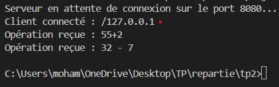
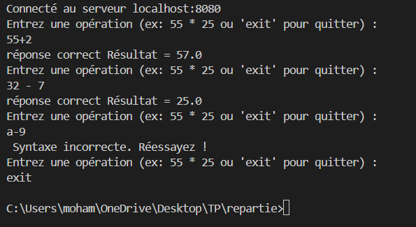

# TP2 : Application Client/Serveur avec Sockets Java
Dans ce TP, nous avons créé un client Java qui se connecte à un serveur via le réseau. L’utilisateur peut saisir une opération mathématique, comme `55 * 25`, puis le client l’envoie au serveur et affiche le résultat reçu. Le programme vérifie aussi si l’opération est correcte et permet de quitter avec la commande `exit`.

## Execution

